<p align="center">
  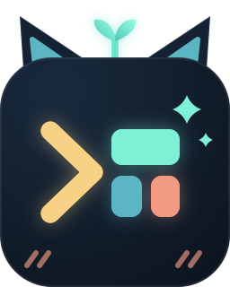
</p>

# masil

[English](README.md) · **한국어**

[](https://github.com/Ochichan/masil/actions/workflows/ci.yml)
[](https://github.com/Ochichan/masil/releases)
[](#설치)
[](LICENSE)

**masil**은 여러 AI 코딩 에이전트를 한 터미널에서 나란히 실행하고 지휘하는 tmux 호환 네이티브 워크스페이스입니다. 원할 때만 켤 수 있는 Noise NK 종단간 암호화(E2EE) 모바일 앱으로 스마트폰에서도 진행 상황 확인, 승인 응답, `localhost` 프리뷰, 프롬프트 전송까지 처리할 수 있습니다.

**Claude Code**, **Codex**, **OpenCode**, **Antigravity CLI (`agy`)**, **Gemini CLI**, **Cursor** 등 24개 코딩 CLI를 실제 C 네이티브 패널에서 그대로 실행하면서 기존 `~/.tmux.conf`, `C-b` 단축키, 네이티브 터미널 속도를 지킵니다. C 기반 tmux 포크 코어(`core/`), Rust 오케스트레이터·TUI(`agent/`), Expo React Native 모바일 앱(`mobile/`)으로 구성됩니다.

[설치](#설치) · [빠른 시작](#빠른-시작) · [기능 둘러보기](#기능-둘러보기) · [모바일 동반 앱](#모바일-동반-앱) · [보안 및 샌드박스](#보안-및-샌드박스) · [로컬 플러그인](#로컬-플러그인) · [필수 단축키](#필수-단축키)

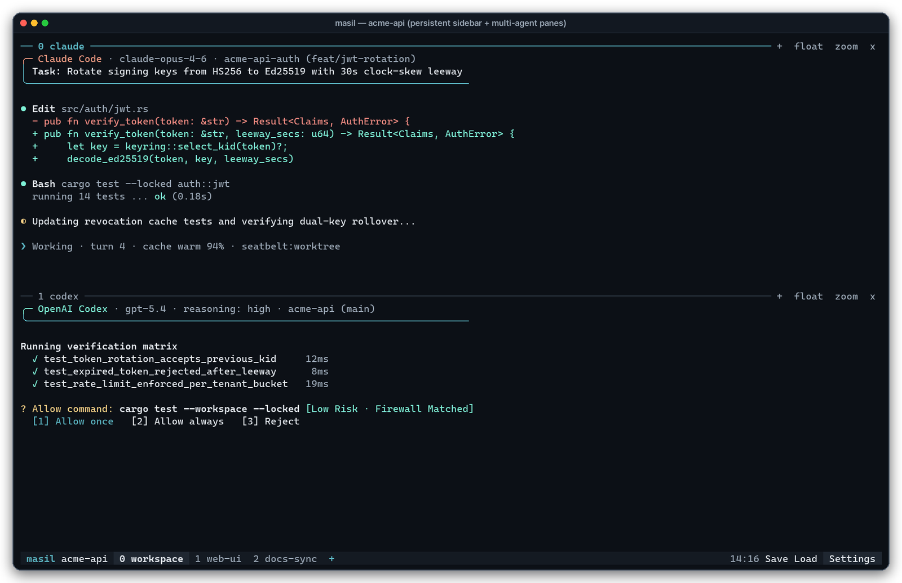

[에이전트 데스크 TUI 보기](docs/public/media/agent-desk.png) · [커맨드 팔레트 보기](docs/public/media/command-palette.png) · [모바일 앱 스크린샷 보기](#모바일-동반-앱)

---

## 왜 masil인가요?

AI 코딩 에이전트를 서너 개 동시에 돌리면 금세 같은 병목이 생깁니다.

- 어느 패널이 작업 중이고, 대기 중인지, 재시도 루프에 빠졌는지, 승인 프롬프트에서 멈췄는지 놓치기 쉽습니다.
- 여러 Git 워크트리가 같은 파일을 동시에 건드리거나, 격리되지 않은 명령이 저장소 밖 파일을 수정할 위험이 있습니다.
- 자리를 잠시 비우면 진행 확인이나 승인, 로컬 개발 서버 확인을 위해 좁은 휴대폰 화면에서 SSH를 열어야 합니다.

masil은 무거운 일렉트론으로 터미널을 감싸거나 셸 입출력 경로에 프록시를 끼우지 않고 이 문제를 해결합니다.

- **네이티브 C 터미널 코어:** tmux(`next-3.9`)에서 파생된 `core/`가 PTY, VT 파싱, 스크롤백, 렌더링을 원래 속도 그대로 담당합니다. 시스템 `tmux` 바이너리와 소켓은 건드리지 않습니다.
- **원본 CLI 그대로 실행:** `claude`, `codex`, `opencode`, `agy` 등 원본 도구를 포크하지 않고 패널에서 직접 실행·관찰합니다.
- **기본 ON 보안과 격리:** 관리형 에이전트는 기본적으로 OS 마이크로 샌드박스(macOS Seatbelt / Linux Bubblewrap) 안에서 실행되며, 결정론적 제로트러스트 권한 방화벽과 SQLite 감사 로그가 함께 동작합니다.
- **근거 기반 상태 보고:** 실제 확인된 프로세스 상태, 화면 시그널, 프로바이더 콜백만 표시하며 작업 완료를 추측하거나 외부 API에 승인 권한을 넘기지 않습니다.
- **기본 백그라운드 데몬 없음:** 일반 `masil` 사용 시 네트워크 서버가 뜨지 않으며 Node.js 런타임도 필요 없습니다. 원격 모바일 게이트웨이는 사용자가 켤 때만 동작합니다.

---

## 설치

패키지 관리자(Homebrew, Nix, AUR)는 `masil`, `masil-agent`와 필요한 C 런타임 라이브러리(`libevent`, `ncurses`, `utf8proc`, `jemalloc`)를 한 번에 설치합니다. 직접 설치 스크립트(`install.sh`)는 SHA-256을 검증해 사전 빌드 아카이브를 설치하며(`--build`로 소스 빌드 가능), 누락된 라이브러리를 안내합니다.

| 환경 / 채널 | 명령어 |
| --- | --- |
| **macOS / Linux (Homebrew 탭, 릴리스)** | `brew install Ochichan/tap/masil` |
| **macOS / Linux (Homebrew, `main` HEAD)** | `brew tap Ochichan/masil https://github.com/Ochichan/masil && brew install --HEAD Ochichan/masil/masil` |
| **Linux / macOS ([Nix](https://nixos.org/download))** | `nix run github:Ochichan/masil` |
| **Arch Linux (AUR)** | `yay -S masil` |
| **macOS / Ubuntu 24.04 (직접 설치 스크립트)** | `curl -fsSL https://github.com/Ochichan/masil/releases/latest/download/install.sh \| bash` |
| **소스에서 빌드** *(macOS / Linux)* | `./install.sh --build` 또는 `make && make install` *(`~/.local` 설치, 다른 경로는 `PREFIX=/path` 지정)* |
| **셀프 호스팅 E2EE 릴레이** *(선택)* | `make relay` 또는 `cd relay && docker compose -f docker-compose.example.yml up -d` |
| **모바일 앱** *(Android / iOS)* | `cd mobile && npm ci && npm run build:apk:arm64` *(iOS: `npm run build:ios:local`)* |

Homebrew 업데이트는 `brew upgrade Ochichan/tap/masil`(또는 `brew upgrade --fetch-HEAD Ochichan/masil/masil`)로 진행합니다. Windows는 호스트로 지원하지 않습니다.

<details>
<summary><b>다운로드 검증하기</b> <i>(선택)</i></summary>

모든 태그 릴리스는 4개 Unix 타깃(`macos-arm64`, `macos-x86_64`, `linux-x86_64`, `linux-arm64`) 아카이브와 소스 아카이브에 대해 `SHA256SUMS`, 릴리스 고정 `install.sh`, GitHub 빌드 출처 증명(Build Provenance Attestation)을 함께 배포합니다:

```sh
# 릴리스에 고정된 설치 스크립트 실행 (SHA256SUMS 자동 검증):
curl -fsSL https://github.com/Ochichan/masil/releases/latest/download/install.sh | bash

# 수동 체크섬 검증 (아카이브와 SHA256SUMS가 같은 디렉터리에 있을 때):
sha256sum -c --ignore-missing SHA256SUMS        # macOS: shasum -a 256 -c --ignore-missing SHA256SUMS

# 빌드 출처 증명 검증 (이 저장소의 릴리스 워크플로에서 빌드되었음을 증명):
gh attestation verify masil-vX.Y.Z-linux-x86_64.tar.gz --repo Ochichan/masil
```

자세한 공급망 보안 및 배포 채널 구성은 [SECURITY.md](SECURITY.md)와 [packaging/README.md](packaging/README.md)를 참고하세요.

</details>

<details>
<summary><b>런타임 라이브러리 및 설치 세부 안내</b></summary>

사전 빌드 아카이브(`macos-arm64`, `macos-x86_64`, `linux-x86_64`, `linux-arm64`)나 소스 빌드에는 아래 런타임 라이브러리가 필요합니다.

- **macOS:** `brew install libevent ncurses utf8proc jemalloc`
- **Ubuntu 24.04:** `sudo apt-get install libevent-core-2.1-7t64 libncursesw6 libtinfo6 libutf8proc3 libjemalloc2`

`make install`은 `$(PREFIX)/lib/masil/<sha256>` 아래에 버전별 번들을 준비한 뒤 `current` 심볼릭 링크를 원자적으로 교체하므로 실행 중인 서버에 영향을 주지 않습니다. 자세한 내용은 [docs/public/install.md](docs/public/install.md)를 참고하세요.

</details>

---

## 빠른 시작

### 1. 터미널 워크스페이스 시작

```sh
masil
```

masil 안에서 관리형 에이전트를 띄우거나 평소처럼 직접 CLI를 실행하면 자동으로 감지됩니다.

```sh
masil-agent agent start api-auth claude --cwd ~/Projects/acme-api
masil-agent agent start test-suite codex --cwd ~/Projects/acme-api --split %0
masil-agent agent list
```

### 2. 에이전트 데스크 또는 상시 사이드바 열기

```sh
masil-agent agent ui        # 전체 화면 에이전트 데스크 (마우스·키보드, 한국어/영어, 다크/라이트/터미널)
masil-agent agent sidebar   # 34컬럼 상시 사이드 패널 (네이티브 tmux 줌으로 확장)
```

1. **`j`/`k`** 또는 방향키로 이동하고 **`g`**를 누르면 해당 에이전트의 라이브 터미널 패널로 즉시 이동합니다.
2. **`/`**로 실시간 검색합니다(**한국어 초성 검색 지원**: `ㄱㅂ` 입력 시 `개발서버` 검색).
3. **`:`**로 **커맨드 팔레트**를 열어 에이전트, 권한 방화벽, 에이전트 아레나, 타임트래블 DVR, 포커스 쉴드, 90초 브리핑, 플러그인을 한 번에 실행합니다.
4. 언제든 **`?`**를 누르면 현재 단축키 치트시트를 볼 수 있습니다.

### 3. 선택 사항: Noise NK E2EE로 스마트폰 연결

```sh
masil-agent remote setup
```

4개 탭으로 구성된 터미널 마법사가 프로바이더 마커 훅 설치(기존 사용자 훅 보존), LAN/Tailscale 직접 접속 또는 셀프 호스팅 릴레이 설정, 백그라운드 서비스(`launchd` / `systemd`), 5분 유효 1회용 QR 페어링(`o` 키로 브라우저 SVG QR 열기)을 순서대로 안내합니다.

---

## 성능 및 리소스

macOS arm64 환경(`2026-11-18`)에서 `masil` 코어와 [Herdr 0.9.5](https://github.com/herdrdev/herdr/releases/tag/v0.9.5)를 1·15·50개 패널(93×39 그리드, 120×40 호스트 PTY, 약 1 MiB/s 페이싱 출력) 기준으로 교차 2라운드 측정한 결과입니다. 전체 측정 조건과 재현 방법은 [performance-2026-11-18.md](docs/public/performance-2026-11-18.md) 및 [validation.md](docs/public/validation.md)에 공개되어 있습니다.

| 지표 | masil 코어 | Herdr 0.9.5 |
| --- | --- | --- |
| **50개 패널 유휴 서버 RSS** | **4.69–4.73 MiB** | 27.63–27.92 MiB |
| **입력 RTT (중앙값)** | **2.44–2.47 ms** | 3.03–3.11 ms |
| **입력 RTT (P99)** | **2.59–2.84 ms** | 3.24–3.32 ms |
| **단일 패널 페이싱 출력 CPU** | 4.63–5.16% | 2.58–2.78% |
| **50개 패널 페이싱 출력 CPU** | **4.32–4.84%** | 9.80–10.62% |

> 범위는 교차 스모크 라운드의 관측값입니다. `core/`는 순수 C로 유지되어 터미널 바이트 경로에 Rust 런타임이 끼어들지 않으며, 관리 기능(`coordinator`·`Agent Desk`)은 로컬 브리지 소켓을 통해 대역 외(out-of-band)로 동작합니다.

---

## 기능 둘러보기

### 에이전트 데스크 & 커맨드 팔레트

로컬 패널과 SSH 원격 호스트의 모든 에이전트를 한 화면에서 조회·제어합니다. 각 행에는 근거 기반 상태(`Working`, `Waiting / Needs input`, `Idle`), 인박스 카운트, 근거 신선도, 세션 바인딩 정보가 표시됩니다.

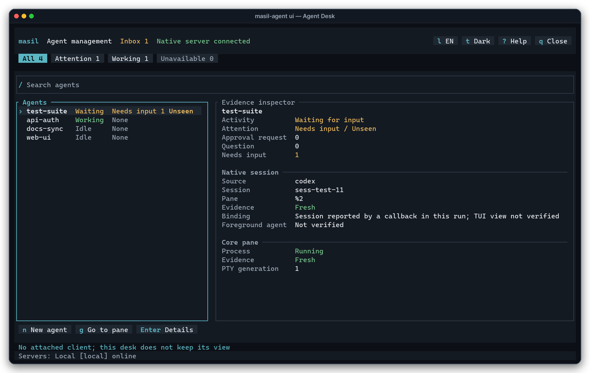

에이전트 데스크 어디서든 **`:`**를 누르면 퍼지 검색 커맨드 팔레트로 에이전트, 패널, 방화벽, 아레나, DVR, 브리핑, 플러그인을 즉시 호출할 수 있습니다.

<details>
<summary>커맨드 팔레트 (`:`) 화면 보기</summary>

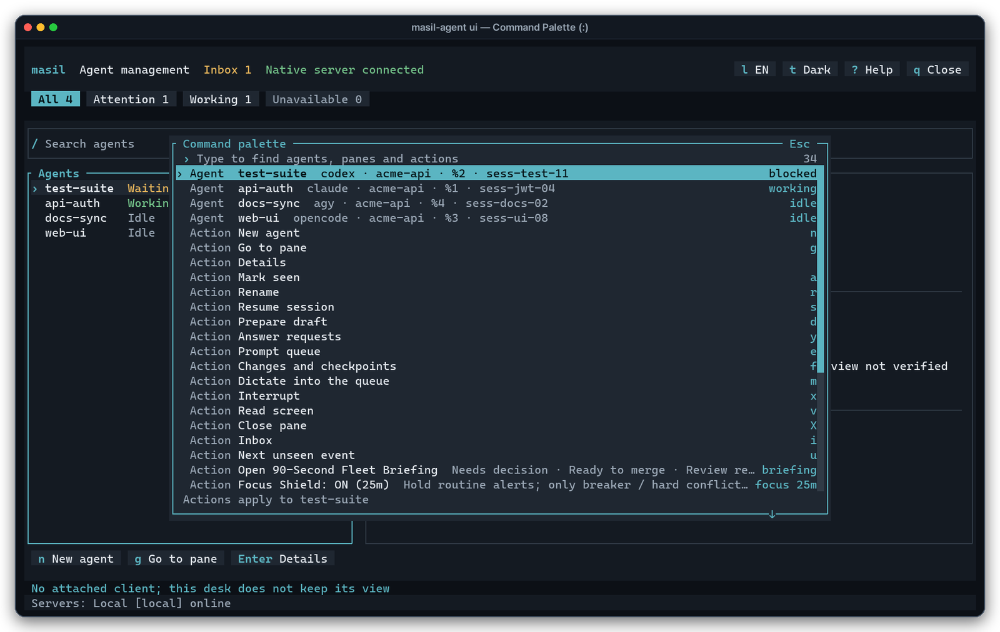

</details>

- **24개 AI 코딩 CLI 인식:** **Claude Code**, **Codex**, **OpenCode**, **Antigravity CLI (`agy`)**는 데스크톱·모바일 완전 연동(마커 훅, 실시간 대화 동기화, 모델·추론 강도·모드 전환)을 지원하며, Gemini CLI, Cursor, GitHub Copilot CLI, Amp, Kilo, OMP 등 **18개 프로바이더**의 네이티브 세션 재개를 지원합니다. `masil-agent agent providers` 또는 [docs/public/providers.md](docs/public/providers.md) 참고.
- **내장 마우스 UI 레이어:** 클릭형 창 탭, `+` 버튼, 플로팅 패널 드래그, 스크롤바, 세션 스냅샷(`prefix C-s` 저장, `prefix C-r` 복원, 15분 자동 저장)을 제공합니다. 순정 tmux 동작만 원하면 `masil -f /dev/null`로 시작하세요.
- **중복 방지 프롬프트 전송:** `masil-agent agent prompt NAME '테스트 실행'`은 유휴 전경 프로세스를 확인하고 SQLite에 먼저 기록한 뒤 전송해 재시도 시 중복 입력을 방지합니다.

---

<a id="보안-및-샌드박스"></a>

### 제로트러스트 권한 방화벽 & 기본 ON OS 마이크로 샌드박스

모든 관리형 에이전트는 기본적으로 **OS 샌드박스 안에서 격리 실행**되며, 도구 승인 앞단에 감사 가능한 권한 방화벽이 자리합니다.

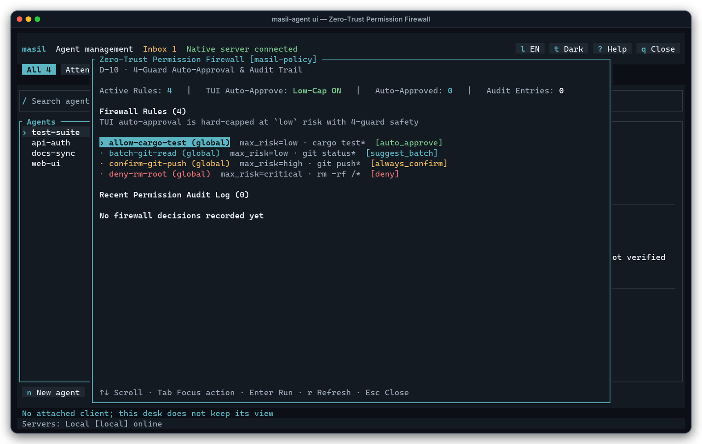

- **기본 ON OS 마이크로 샌드박스 (`--sandbox worktree|strict|net-off`):**
  - macOS에서는 **Seatbelt**(`/usr/bin/sandbox-exec`), Linux에서는 **Bubblewrap**(`bwrap`)을 사용해 파일 쓰기 범위를 해당 에이전트의 Git 워크트리로 격리합니다.
  - 패널 기동 시 `@masil-sandbox` 배지(`seatbelt:worktree`, `bwrap:strict` 등)를 원자적으로 기록합니다. 해제가 꼭 필요할 때만 명시적으로 `--no-sandbox`를 전달하며, 외부 MCP/API에서는 샌드박스 해제가 원천 차단됩니다.
  - 저장소별 `.masil/sandbox.toml`은 SHA-256 2단계 신뢰 승인(`masil-agent sandbox trust REPO --confirm SHA256`) 후 적용됩니다. `masil-agent doctor`로 백엔드 상태를 즉시 확인할 수 있습니다.
- **제로트러스트 권한 방화벽 (`masil-agent policy`):**
  - 결정론적 영향 반경(Blast-Radius) 분류기가 모든 명령을 `ReadOnly` / `Low` / `Medium` / `High` / `Critical`로 판정합니다.
  - **4중 가드 저위험 TUI 자동 승인:** TUI 자동 승인은 `Low` 등급으로 상한이 고정되며 4가지 가드(명시적 규칙 매칭, 서킷 브레이커 정상, 활성 TUI 데스크, 명령 정확 일치)가 모두 통과할 때만 실행됩니다. High/Critical 요청은 항상 사람만 승인할 수 있으며, 일괄 승인(Batch Approve)도 `Low` 등급에만 허용됩니다.
  - 모든 허용·거부·자동 승인·규칙 철회 내역이 SQLite 감사 원장(`masil-agent policy log`)에 기록됩니다.

---

### Best-of-N 에이전트 아레나 (Agent Arena)

Claude Code와 Codex 중 어느 쪽이 더 깔끔한 패치를 낼지 고민될 때, 격리된 병렬 Git 워크트리에서 동시에 레이스시키고 검증 결과로 승자를 안전하게 승격하세요.

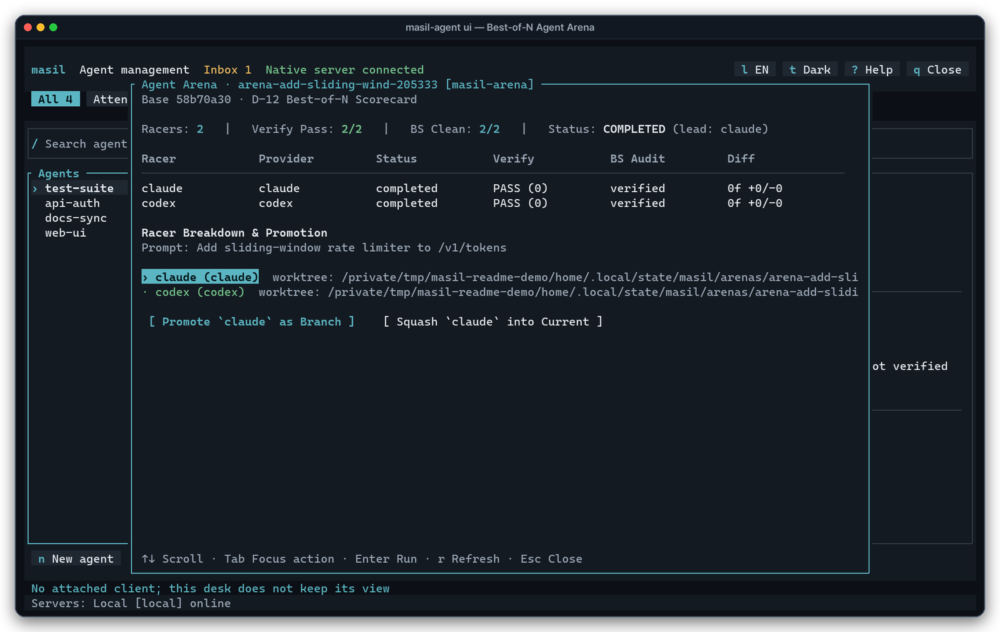

```sh
masil-agent arena start "Add sliding-window rate limiter to /v1/tokens" \
  --racers claude,codex --verify-cmd "cargo test --locked"
masil-agent arena verify <ARENA_ID>
masil-agent arena promote <ARENA_ID> --winner claude --mode branch --losers archive
```

- **한눈에 비교하는 스코어카드:** `--verify-cmd` 종료 코드, 크로스 프로바이더 BS 감사 판정, 소요 시간, 변경 파일·라인 규모를 레이서별로 나란히 비교합니다.
- **안전한 승격과 정리:** 승자는 새 브랜치(`--mode branch`) 또는 현재 브랜치 스쿼시(`--mode squash`, 작업 트리가 더러우면 자동 안전 체크포인트 생성)로 반영하고, 패자는 아카이브(`--losers archive`) 또는 즉시 정리(`--losers clean`)를 선택합니다. 필요하면 `masil-agent arena synthesize <ARENA_ID> --judge claude`로 장점만 합성할 수도 있습니다.

---

### 플릿 인텔리전스, 타임트래블 DVR & 포커스 쉴드

여러 에이전트를 장시간 돌려도 놓치는 일 없이 검증하고 되돌릴 수 있는 안전장치입니다.

- **크로스 프로바이더 BS 탐지기 (`masil-agent agent audit`):** 에이전트의 직전 턴 주장을 실제 Git diff와 관측된 명령 출력에 대조해 거짓 완료·생략된 테스트를 짚어내고 반박 프롬프트를 바로 보냅니다.
- **크로스 워크트리 충돌 레이더 (`masil-agent worktree conflicts|shadow-check|warn`):** Git 오브젝트를 오염시키지 않고 형제 워크트리 간 중복 편집을 감지하며, 섀도우 병합 테스트나 형제 에이전트 경고를 보낼 수 있습니다.
- **폭주 서킷 브레이커 & 프롬프트 캐시 보온 (`masil-agent agent guard`):** 반복 실패 루프를 조기에 차단해 토큰 낭비를 막고, 캐시가 살아있는 세션을 우선 정렬해 보여 줍니다.
- **타임트래블 DVR & 제로-CDN 마스킹 HTML 트레이스 (`masil-agent agent dvr` / `agent trace export`):**
  - 턴마다 Git 트리 스냅샷을 저장(모델 편집뿐 아니라 Bash 부수 효과까지 포함)하고, 핵심 마일스톤을 영구 고정(`dvr pin`)하거나 원하는 시점으로 파일 복원(`dvr restore`)·새 브랜치 분기(`dvr fork`)할 수 있습니다.
  - `masil-agent agent trace export NAME --out pr-trace.html --redact-strict`로 외부 CDN 의존성 없이 시크릿이 마스킹된 단일 HTML 리뷰 트레이스를 뽑아 PR에 첨부할 수 있습니다.
- **포커스 쉴드 & 90초 복귀 브리핑 (`masil-agent focus` / `masil-agent briefing`):**
  - `masil-agent focus on 60m`으로 집중 시간 동안 일반 알림을 보류하되 서킷 브레이커 작동이나 하드 충돌만 즉시 통과시킵니다.
  - 자리로 돌아오면 `masil-agent briefing`이 **결정 필요 · 머지 준비 · 리뷰 필요** 3단으로 90초 요약을 만들어 줍니다.
- **옵트인 Live Pulse:** iOS Live Activities(잠금화면/다이내믹 아일랜드) 및 Android 상시 진행 알림을 지원하며 **기본값은 꺼짐(명시적 옵트인)**입니다.

---

<a id="모바일-동반-앱"></a>

### 모바일 동반 앱 (`mobile/`)

Android·iOS에서 **Noise NK 종단간 암호화(E2EE)**로 호스트 플릿을 실시간 제어합니다. LAN/Tailscale에서는 외부 서버 없이 직접 연결(`7767` 포트)되며, 필요할 때만 셀프 호스팅 `masil-relay`를 경유합니다.

<p align="center">
  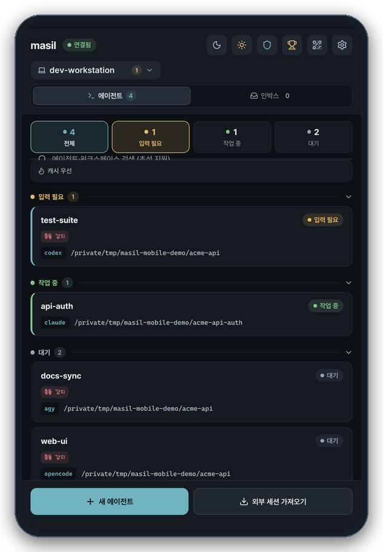
  &nbsp;
  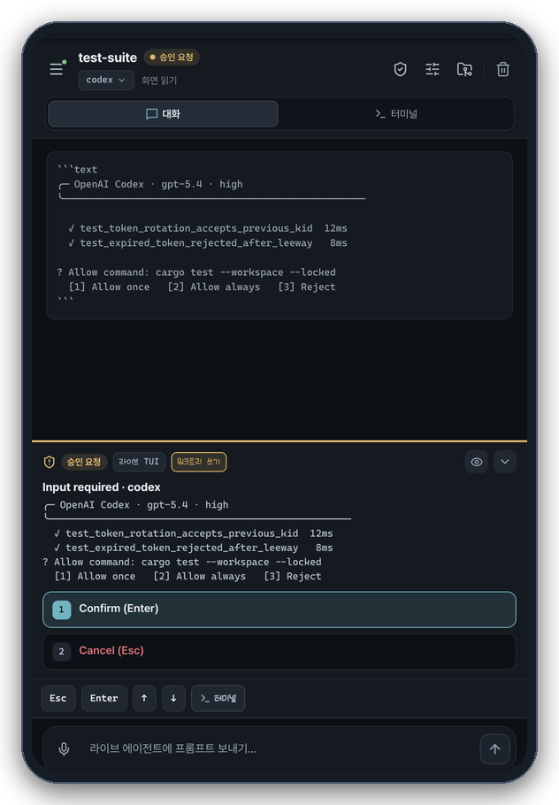
  &nbsp;
  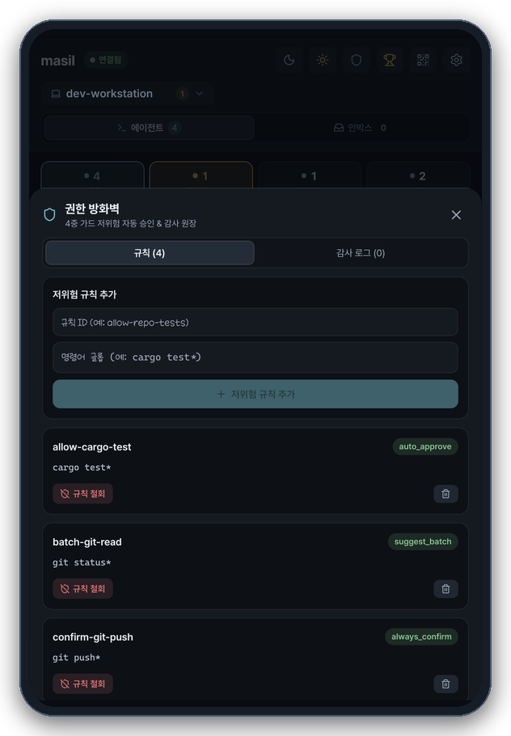
</p>

<p align="center">
  <em>왼쪽: 멀티 프로바이더 플릿 & 충돌 레이더 · 가운데: 실시간 승인 카드 & 리스크 배지 · 오른쪽: 제로트러스트 권한 방화벽</em>
</p>

<details>
<summary><b>모바일 추가 화면 & 호스트 E2EE 설정 마법사 보기</b></summary>

<p align="center">
  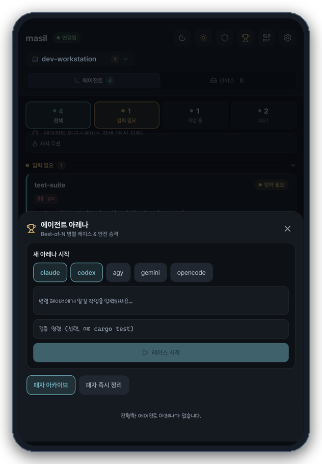
  &nbsp;&nbsp;
  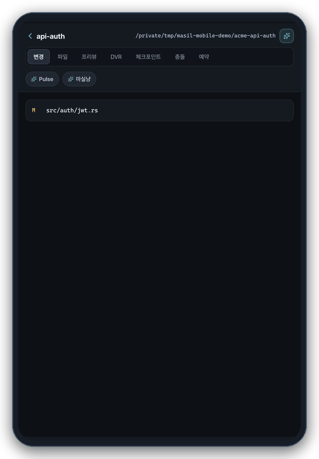
</p>

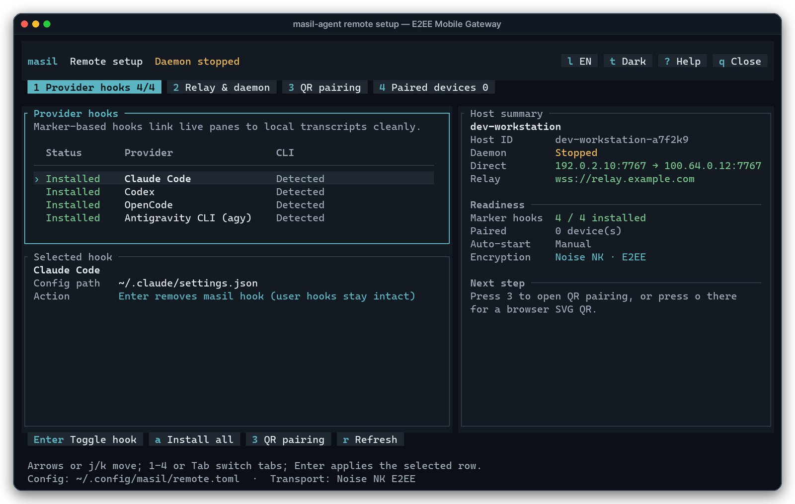

</details>

모바일 앱 핵심 기능:

- **대화 중심 뷰 + 네이티브 라이브 터미널:** 연속 도구 호출은 1줄 요약으로 접어 깔끔하게 읽고, 직접 키 입력이 필요하면 상단 **터미널** 탭(`masil-terminal`)으로 즉시 전환합니다.
- **실시간 승인 카드 & 리스크 배지:** TUI 승인 프롬프트와 질문에 원탭으로 응답하고, 저위험 승인 요청만 안전하게 일괄 승인할 수 있습니다.
- **E2EE Localhost 프리뷰 터널 + 화면 마크업:** 호스트에서 실행 중인 개발 서버(`localhost:3000`, `:5173` 등)를 네이티브 루프백 프록시(`masil-tunnel-proxy`)로 폰에서 바로 미리보고, 화면에 직접 주석을 그려 에이전트에게 전송합니다(임시 캡처 파일은 `.git/info/exclude`로 제외되어 `git status`를 어지럽히지 않습니다).
- **시각적 에이전트 실행기 & 워크스페이스 도구:** 호스트 폴더 탐색기, 프로바이더·모델·추론 강도·실행 모드·샌드박스·새 Git 워크트리 선택, 실시간 Git Diff, DVR 타임라인 탐색, 체크포인트, 음성 받아쓰기, 멀티 호스트 전환을 지원합니다.
- **셀프 호스팅 릴레이 (`relay/`):** Tailscale 없이 외부 네트워크에서 접속하려면 작은 VPS에 `masil-relay`를 띄우고(`make relay` 또는 Docker) `masil-agent remote pair --relay wss://your-relay.example.com`으로 페어링하세요. 릴레이는 암호화된 Noise NK 봉투만 중계합니다.

---

<a id="로컬-플러그인"></a>

### 로컬 플러그인 (Claude Code · Codex · Antigravity 즉석 제작)

바이너리나 모바일 APK를 다시 빌드하지 않고 Rust TUI와 모바일 앱 양쪽을 확장할 수 있습니다. 모든 플러그인은 `~/.config/masil/plugins/<id>/`(또는 경로 등록 폴더)에 저장되며 연결된 모든 클라이언트에 핫 리로드됩니다.

플러그인 하나(`masil-plugin.toml`)에 6가지 확장 요소를 자유롭게 조합할 수 있습니다.

1. **테마 (`theme.toml`):** 코드 없이 Omarchy 스타일 헥스 팔레트만으로 TUI와 모바일 테마를 동시 동기화.
2. **워크스페이스 패널:** Masil UI Spec v1 선언형 블록(`metric_row`, `table`, `list`, `markdown`, `code`, `diff`, `progress`, `sparkline`, `callout`, `button`, `toggle`, `select`, `form`)을 모바일 도구 탭과 TUI 팔레트(`:`)에서 네이티브 렌더링.
3. **슬래시 커맨드:** 모바일 입력창 `/` 자동완성과 TUI 팔레트에 등록.
4. **타임라인 카드:** 에이전트 대화 타임라인에 영속적으로 표시되는 구조화 카드.
5. **라이프사이클 훅:** `agent.state_changed`, `agent.started`, `agent.closed`, `inbox.event`, `theme.changed`, `prompt.before` 이벤트 구독.
6. **실행 프리셋:** 자주 쓰는 프로바이더·모델·추론 강도·모드·워크트리·초기 프롬프트 조합을 원탭 실행 칩으로 등록.

#### 공식 `masil-plugin` AI 스킬 설치

```sh
masil-agent plugin skill install --target all
masil-agent plugin skill status
```

설치 후 Claude Code, Codex, Antigravity에서 바로 요청하거나 모바일(**설정 → 플러그인 → AI로 플러그인 만들기**)·TUI 팔레트(`:` → **AI로 Masil 플러그인 만들기**)에서 **Creator Mode**를 실행하세요.

- *"masil용 Tokyo Night 다크 테마 플러그인 만들어서 바로 적용해줘."*
- *"현재 저장소 TODO 체크리스트를 관리하는 masil 패널과 `/todo` 슬래시 커맨드 만들어줘."*
- *"에이전트가 blocked 상태가 되면 대화 타임라인에 알림 카드를 남기는 masil 훅 플러그인 만들어줘."*

기본 예제 플러그인 체험:

```sh
masil-agent plugin install examples/plugins/catppuccin-mocha
masil-agent plugin install examples/plugins/repo-pulse
masil-agent plugin theme set catppuccin-mocha
```

플러그인의 FD 3 API 호출은 선언된 `scope = read|act|admin`으로 제한되며 승인 프롬프트는 항상 사람만 응답할 수 있습니다. 자세한 명세는 [docs/public/plugins.md](docs/public/plugins.md)를 참고하세요.

---

<a id="필수-단축키"></a>

## 필수 단축키

**에이전트 데스크**(`masil-agent agent ui`) 및 **사이드바**(`masil-agent agent sidebar`) 기본 단축키입니다.

| 키 | 동작 |
| --- | --- |
| `j` / `k` · `↑` / `↓` | 선택 이동 (`Tab` 후 인스펙터 스크롤) |
| `/` | 실시간 필터·검색 *(한국어 초성 검색 지원: `ㄱㅂ` → `개발서버`)* |
| `:` | **커맨드 팔레트** 열기 *(에이전트, 방화벽, 아레나, DVR, 브리핑, 포커스 쉴드, 플러그인)* |
| `g` | 선택한 에이전트의 실제 터미널 패널로 즉시 이동 |
| `Enter` | 에이전트 상세 보기 / 강조된 팔레트 항목 실행 |
| `n` / `s` | 새 관리형 에이전트 시작 / 저장된 세션 재개 |
| `p` / `d` / `e` | 안전한 프롬프트 전송 / 초안 버퍼 준비 / 프롬프트 큐 열기 |
| `y` / `i` / `u` | 승인·질문 응답 / 인박스 토글 / 다음 미확인 이벤트로 이동 |
| `f` / `v` / `m` | Git 변경 내역·체크포인트 / 실시간 화면 읽기 / 음성 받아쓰기 |
| `x` / `X` / `r` | 에이전트 인터럽트 / 패널 닫기 / 이름 변경 |
| `z` | 네이티브 tmux 패널 줌으로 사이드바 확대/복귀 |
| `l` / `t` | 언어 전환 (`EN` / `KO`) / 테마 전환 (`Dark` / `Light` / `Terminal`) |
| `?` / `q` | 라이브 단축키 도움말 / 에이전트 데스크 닫기 |

`masil` 세션 안에서는 기존 tmux 기본 바인딩(`C-b` 프리픽스)이 그대로 동작하며, `prefix C-s`로 세션 스냅샷을 저장하고 `prefix C-r`로 복원할 수 있습니다.

---

## CLI 레퍼런스

<details>
<summary><b>에이전트 수명주기, 워크트리 & 레이아웃</b></summary>

```sh
masil-agent agent providers                                  # 감지된 CLI 및 근거 목록
masil-agent agent start NAME PROVIDER [--cwd DIR] [--worktree W] [--split %N]
masil-agent agent list [--all]                               # 로컬 + SSH 전체 플릿 조회
masil-agent agent prompt NAME "테스트 실행"                   # SQLite 기록 기반 중복 방지 전송
masil-agent agent wait NAME --state idle --timeout 600       # 스크립트용 상태 대기
masil-agent agent changes NAME                               # 에이전트 워크트리 수정 파일 목록
masil-agent agent checkpoint NAME make|list|restore ...      # 미리보기 기반 개별 파일 롤백
masil-agent agent endpoints add|connect|status ...           # 멀티 머신 SSH 플릿 제어
masil-agent worktree create REPO BRANCH [--setup]            # 격리된 Git 워크트리 생성
masil-agent layout apply NAME --yes                          # TOML 멀티 패널 템플릿 적용
masil-agent layout columns on                                # 가로 스크롤 고정 너비 컬럼 레이아웃
```

</details>

<details>
<summary><b>권한 방화벽, OS 샌드박스, 에이전트 아레나 & 타임트래블 DVR</b></summary>

```sh
# 제로트러스트 권한 방화벽
masil-agent policy list
masil-agent policy check "cargo test --locked" --cwd .
masil-agent policy add --id allow-tests --match-command "cargo test*" --max-risk low --action auto_approve
masil-agent policy revoke allow-tests
masil-agent policy log --limit 20

# OS 마이크로 샌드박스 (관리형 에이전트 기본 ON)
masil-agent sandbox status --repo .
masil-agent sandbox trust . --confirm <SHA256>
masil-agent agent start build claude --cwd . --sandbox strict   # worktree | net-off | --no-sandbox

# Best-of-N 에이전트 아레나
masil-agent arena start "<작업 지시>" --racers claude,codex --verify-cmd "cargo test"
masil-agent arena list
masil-agent arena verify <ARENA_ID>
masil-agent arena promote <ARENA_ID> --winner claude --mode branch --losers archive
masil-agent arena synthesize <ARENA_ID> --judge claude

# 타임트래블 DVR & 제로-CDN 마스킹 HTML 트레이스
masil-agent agent dvr list NAME
masil-agent agent dvr snapshot NAME --note "리팩터링 전"
masil-agent agent dvr pin NAME --turn 1 --note "클린 기준점"
masil-agent agent dvr restore NAME --turn 1
masil-agent agent dvr fork NAME --turn 1 --branch try/alt-approach
masil-agent agent trace export NAME --out pr-trace.html --redact-strict
```

</details>

<details>
<summary><b>인텔리전스, 충돌 레이더, 포커스 쉴드 & 원격 모바일 게이트웨이</b></summary>

```sh
# 인텔리전스 & 안전장치
masil-agent agent audit NAME [--turn latest] [--challenge FINDING_ID]
masil-agent agent guard NAME status|extend|dismiss
masil-agent worktree conflicts [REPO]
masil-agent worktree shadow-check WT_A WT_B --cmd "cargo test"
masil-agent worktree warn TARGET --about SIBLING

# 포커스 쉴드 & 90초 복귀 브리핑
masil-agent focus on 60m --reason "핵심 리팩터링"
masil-agent focus status
masil-agent focus off
masil-agent briefing --since 8h

# 옵트인 E2EE 모바일 게이트웨이
masil-agent remote setup
masil-agent remote status
masil-agent remote pair [--relay wss://relay.example.com] [--open]
masil-agent remote devices
masil-agent remote revoke <DEVICE_ID>
masil-agent remote install-service | uninstall-service
```

</details>

---

## 문제 해결

네트워크 호출 없이 로컬 설치·서버·샌드박스·프로바이더 상태를 점검하려면 `masil-agent doctor` (`--versions`, `--bundle DIR`)를 실행하세요.

| 증상 | 해결 방법 |
| --- | --- |
| `doctor`에서 `sandbox.backend` 경고 표시 | macOS는 `/usr/bin/sandbox-exec` 확인, Linux는 Bubblewrap(`sudo apt install bubblewrap`)을 설치하세요. 의도적으로 끌 때만 `--no-sandbox`를 사용합니다. |
| 에이전트 상태가 `unknown`으로 남거나 턴 전환이 늦음 | `masil-agent remote setup-hooks --install all`(또는 `masil-agent agent integration export PROVIDER`)로 마커 훅을 설치하고 새 세션을 시작하세요. |
| 모바일 앱이 LAN 호스트에 연결되지 않음 | `masil-agent remote status`로 데몬 실행 여부와 `7767` 포트 도달 가능성을 확인하거나 셀프 호스팅 `masil-relay`를 통해 페어링하세요. |
| 마우스 UI 레이어 없이 순정 tmux처럼 쓰고 싶음 | `masil -f /dev/null`로 독립 서버를 시작하세요. 기존 시스템 `tmux` 소켓(`tmux-UID`)과 바이너리는 영향을 받지 않습니다. |
| 기존 스크립트가 `tmux` 명령을 직접 호출함 | 해당 셸의 `PATH` 앞에 `compat/`를 추가하면 `tmux` 호출이 `masil`로 연결됩니다. |

---

## 아키텍처, 공개 문서 & 개발

- **명확한 책임 분리:** `core/`(C, tmux `next-3.9` 포크)가 프록시 없이 PTY·VT 파싱·렌더링을 전담합니다. `agent/`(Rust)는 프로바이더 감지, TUI, SQLite 작업 원장, 권한 방화벽, OS 샌드박스, 아레나, DVR, 플러그인, 옵트인 원격 게이트웨이를 담당합니다. `crates/masil-wire/`는 `relay/`·`mobile/`과 공유하는 Noise NK E2EE 와이어 프로토콜을 구현합니다.
- **공개 문서:**
  - [설치 및 업데이트 가이드](docs/public/install.md)
  - [로컬 플러그인 및 AI 스킬 가이드](docs/public/plugins.md)
  - [프로바이더 지원 및 설정](docs/public/providers.md) · [실측 관측 카탈로그](docs/public/provider-observations.md)
  - [아키텍처 및 호환성 경계](docs/public/architecture.md)
  - [검증 및 벤치마크](docs/public/validation.md) · [성능 측정 기록 (2026-11-18)](docs/public/performance-2026-11-18.md)

<details>
<summary><b>기여자용 빌드 & 검증 명령어</b></summary>

```sh
make all && make relay                                  # bin/masil, bin/masil-agent, bin/masil-relay 빌드
cargo fmt --manifest-path agent/Cargo.toml --check
cargo clippy --locked --manifest-path agent/Cargo.toml --all-targets -- -D warnings
cargo test --locked --manifest-path agent/Cargo.toml
make test-ci                                            # 코어 C + 관리 회귀 게이트
make test-relay                                         # Noise NK 와이어·릴레이 Rust 테스트
PYTHONPATH=tests python3 -m unittest -v tests/test_phase1.py tests/test_phase2.py tests/test_phase3.py tests/test_plugins_e2e.py tests/test_remote_e2e.py
cd mobile && npm run typecheck && npm test              # 모바일 앱 TypeScript·Vitest 검증
```

</details>

## 라이선스

**masil**은 [MIT 라이선스](LICENSE)를 따릅니다. `core/`는 tmux에서 파생되어 ISC 라이선스를 유지하며, 모바일 앱에 포함된 폰트(`Pretendard`, `Cascadia Mono`)는 SIL Open Font License 1.1을 따릅니다. 서드파티 고지는 [NOTICE](NOTICE)를 참고하세요.
