<p align="center">
  
</p>

# masil

**English** · [한국어](README.ko.md)

[](https://github.com/Ochichan/masil/actions/workflows/ci.yml)
[](https://github.com/Ochichan/masil/releases)
[](#install)
[](LICENSE)

**masil** is a tmux-compatible native terminal workspace built for running multiple AI coding agents side by side — with an optional Noise NK end-to-end encrypted mobile app to monitor, approve, preview, and steer your fleet from your phone.

Run **Claude Code**, **Codex**, **OpenCode**, **Antigravity CLI (`agy`)**, **Gemini CLI**, **Cursor**, and 18 other coding CLIs directly in native C panes without losing your `~/.tmux.conf`, `C-b` bindings, or terminal speed. Built on a forked C tmux core (`core/`), a Rust orchestrator and TUI (`agent/`), and an Expo React Native companion (`mobile/`).

[Install](#install) · [Quick start](#quick-start) · [Feature tour](#tour) · [Mobile companion](#mobile-companion) · [Safety & sandbox](#safety-and-sandbox) · [Local plugins](#local-plugins) · [Essential keys](#essential-keys)

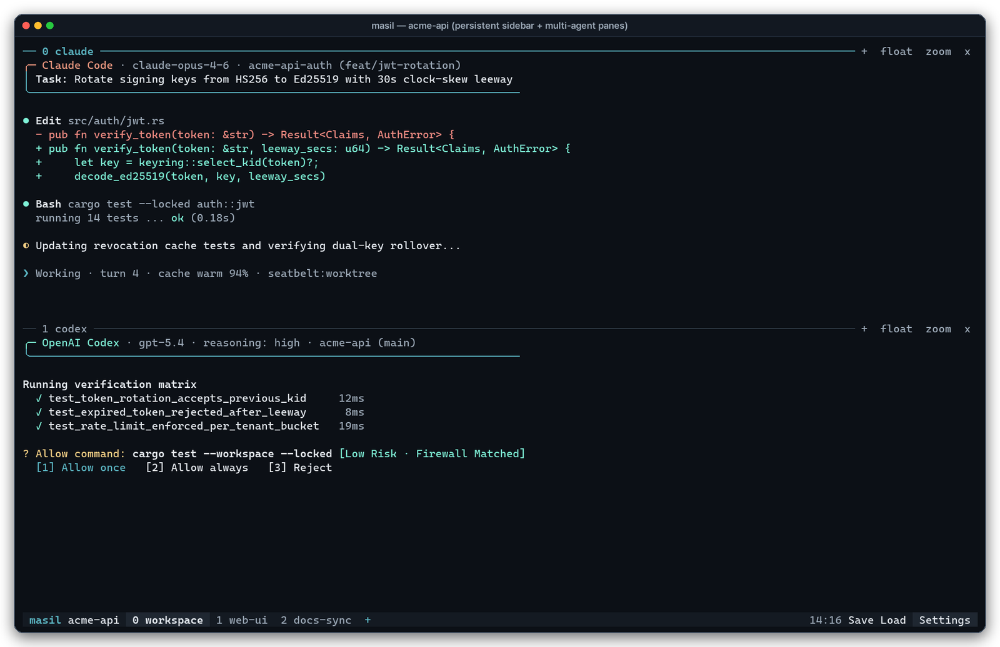

[View Agent Desk TUI](docs/public/media/agent-desk.png) · [View Command Palette](docs/public/media/command-palette.png) · [Jump to Mobile screenshots](#mobile-companion)

---

## Why masil

Running three or four AI coding agents in parallel quickly hits the same walls:

- You lose track of which pane is working, idle, spinning in a retry loop, or waiting on a permission prompt.
- Sibling worktrees silently edit the same files, or an uncontained command writes outside its repo.
- Stepping away from your desk forces awkward SSH sessions on a tiny phone screen just to check progress, preview `localhost`, or answer a prompt.

masil fixes this without wrapping your shell in Electron or inserting a proxy into the terminal byte stream:

- **Native C terminal core.** Derived from tmux (`next-3.9`), `core/` owns PTYs, VT parsing, scrollback, and rendering at full native speed. Stock `tmux` binaries and sockets stay completely untouched.
- **Real agent CLIs, zero forks.** Launches and observes the upstream `claude`, `codex`, `opencode`, `agy`, and other CLIs directly inside panes.
- **Safety on by default.** Managed agents launch inside an OS micro-sandbox (macOS Seatbelt / Linux Bubblewrap) paired with a deterministic Zero-Trust Permission Firewall and immutable SQLite audit trail.
- **Honest, evidence-based state.** Reports only observed process state, screen signals, and provider callbacks — never fakes task completion or grants silent approval to external APIs.
- **Zero background daemons until you opt in.** Plain `masil` starts no network listener and requires no Node.js runtime. Turn on the Noise NK mobile gateway only when you want phone access.

---

## Install

| Target | Command |
| --- | --- |
| **macOS / Linux (Homebrew)** | `brew tap Ochichan/masil https://github.com/Ochichan/masil && brew install --HEAD Ochichan/masil/masil` |
| **Prebuilt archives** *(macOS 15+ arm64, Ubuntu 24.04 x86_64)* | Download archive + `SHA256SUMS` from [GitHub Releases](https://github.com/Ochichan/masil/releases) |
| **From source** *(macOS / Linux)* | `make && make install` *(installs to `~/.local`; override with `PREFIX=/path`)* |
| **Self-hosted E2EE Relay** *(optional)* | `make relay` or `cd relay && docker compose -f docker-compose.example.yml up -d` |
| **Mobile app** *(Android / iOS)* | `cd mobile && npm ci && npm run build:apk:arm64` *(iOS: `npm run build:ios:local`)* |

Update Homebrew installs anytime with `brew upgrade --fetch-HEAD Ochichan/masil/masil`. Windows is not supported as a masil host.

<details>
<summary><b>Runtime libraries & installation details</b></summary>

For prebuilt archives or building from source, ensure these runtime libraries are present:

- **macOS:** `brew install libevent ncurses utf8proc jemalloc`
- **Ubuntu 24.04:** `sudo apt-get install libevent-core-2.1-7t64 libncursesw6 libtinfo6 libutf8proc3 libjemalloc2`

`make install` stages a content-addressed bundle under `$(PREFIX)/lib/masil/<sha256>` and atomically flips `current`, leaving running servers intact until you restart them. See [docs/public/install.md](docs/public/install.md) for full instructions.

</details>

---

## Quick start

### 1. Start a terminal workspace

```sh
masil
```

Launch managed agents in panes (or run your CLIs manually — masil detects active agent panes automatically):

```sh
masil-agent agent start api-auth claude --cwd ~/Projects/acme-api
masil-agent agent start test-suite codex --cwd ~/Projects/acme-api --split %0
masil-agent agent list
```

### 2. Open Agent Desk or the persistent Sidebar

```sh
masil-agent agent ui        # full-screen Agent Desk (mouse + keyboard, EN/KO, Dark/Light/Terminal)
masil-agent agent sidebar   # 34-column side panel that expands via native tmux zoom
```

1. Move with **`j`/`k`** or arrows, press **`g`** to jump straight to that agent's live pane.
2. Press **`/`** for instant search (supports Korean initial consonants: `ㄱㅂ` matches `개발서버`).
3. Press **`:`** to open the **Command Palette** for agents, Permission Firewall, Agent Arena, Time-Travel DVR, Focus Shield, Return Briefing, and plugins.
4. Press **`?`** anytime for the live keybinding cheatsheet.

### 3. Optional: pair your phone over Noise NK E2EE

```sh
masil-agent remote setup
```

The four-tab TUI wizard configures marker hooks (without touching your existing hooks), direct LAN/Tailscale or self-hosted relay transport, background daemon/service control (`launchd` / `systemd`), and a 5-minute one-time pairing QR code (press `o` to open a crisp SVG QR in your browser).

---

## Performance & footprint

Measured on macOS arm64 (`2026-11-18`) across two alternating rounds comparing `masil` core against [Herdr 0.9.5](https://github.com/herdrdev/herdr/releases/tag/v0.9.5) on 1, 15, and 50 panes (93×39 fixture grids, 120×40 host PTY, ~1 MiB/s aggregate paced output). Full methodology, hashes, and caveats live in [performance-2026-11-18.md](docs/public/performance-2026-11-18.md) and [validation.md](docs/public/validation.md).

| Measure | masil core | Herdr 0.9.5 |
| --- | --- | --- |
| **50-pane idle server RSS** | **4.69–4.73 MiB** | 27.63–27.92 MiB |
| **Input RTT (median)** | **2.44–2.47 ms** | 3.03–3.11 ms |
| **Input RTT (P99)** | **2.59–2.84 ms** | 3.24–3.32 ms |
| **Single-pane paced-output CPU** | 4.63–5.16% | 2.58–2.78% |
| **50-pane paced-output CPU** | **4.32–4.84%** | 9.80–10.62% |

> Ranges reflect observed alternating smoke rounds, not confidence intervals. `core/` stays strictly C with no Rust runtime in the terminal byte path; resident management (`coordinator` + `Agent Desk`) runs out-of-band over the local bridge socket.

---

## Tour

### Agent Desk & Command Palette

Monitor every running agent across local panes and SSH endpoints from a single keyboard-and-mouse TUI. Each row surfaces honest state (`Working`, `Waiting / Needs input`, `Idle`), inbox counts, evidence freshness, and session binding without polling loops.

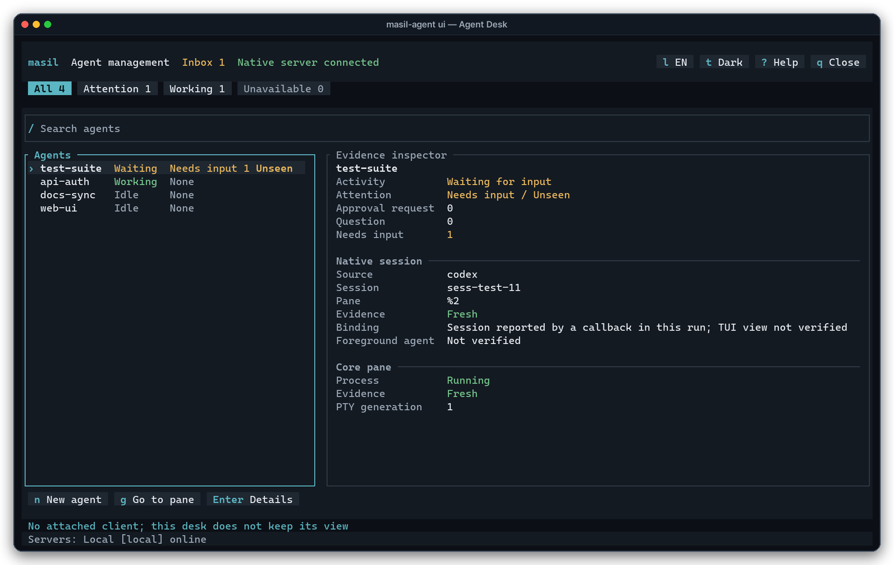

Press **`:`** from anywhere in Agent Desk to jump across agents, panes, plugins, and workspace tools from one fuzzy palette:

<details>
<summary>View the Command Palette (`:`)</summary>

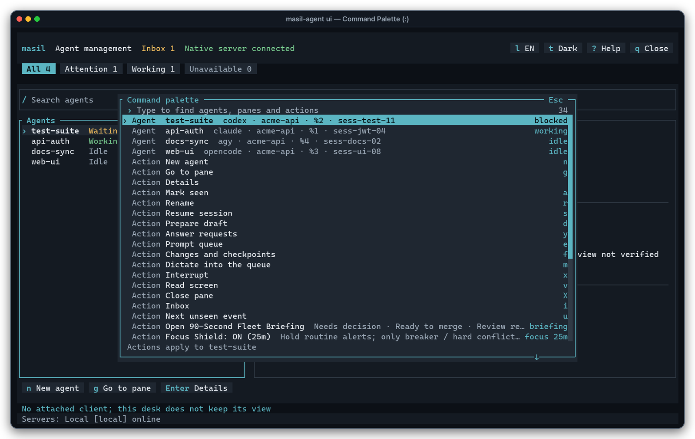

</details>

- **24 coding agent CLIs recognized:** full desktop + mobile support (marker hooks, live conversation sync, model/effort/mode switching) for **Claude Code**, **Codex**, **OpenCode**, and **Antigravity CLI (`agy`)**, plus pane discovery, prompt delivery, and native session resume across **18 providers** including Gemini CLI, Cursor, GitHub Copilot CLI, Amp, Kilo, and OMP. Run `masil-agent agent providers` or see [docs/public/providers.md](docs/public/providers.md).
- **Native mouse UI layer:** clickable window tabs, `+` button, floating pane drag, scrollbars, and session snapshots (`prefix C-s` save, `prefix C-r` restore, optional 15-minute autosave). Start with `masil -f /dev/null` for plain stock tmux behavior.
- **Durable prompt delivery:** `masil-agent agent prompt NAME 'run tests'` verifies idle foreground identity and writes an intent record in SQLite before sending so retries never double-submit.

---

<a id="safety-and-sandbox"></a>

### Zero-Trust Permission Firewall & OS Micro-Sandbox

Every managed agent starts **sandboxed by default** with an auditable firewall in front of tool approvals:

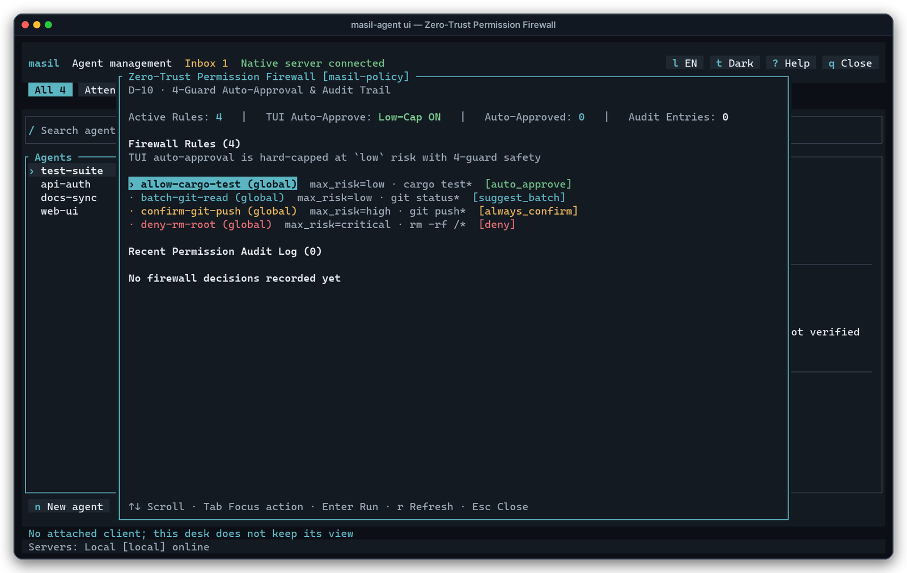

- **Default-ON OS Micro-Sandbox (`--sandbox worktree|strict|net-off`):**
  - Uses **macOS Seatbelt** (`/usr/bin/sandbox-exec`) on macOS and **Bubblewrap** (`bwrap`) on Linux to confine filesystem writes to the agent's task worktree while keeping read access fast.
  - Stamps an atomic `@masil-sandbox` badge (`seatbelt:worktree`, `bwrap:strict`, etc.) at pane launch. Opt out explicitly per run with `--no-sandbox` — external MCP/API callers are hard-blocked from disabling sandboxing.
  - Per-repo `.masil/sandbox.toml` policies require two-step SHA-256 trust confirmation (`masil-agent sandbox trust REPO --confirm SHA256`). Verify host readiness anytime with `masil-agent doctor`.
- **Zero-Trust Permission Firewall (`masil-agent policy`):**
  - Deterministic blast-radius classifier rates every command (`ReadOnly`, `Low`, `Medium`, `High`, `Critical`).
  - **4-Guard Low-Risk TUI Auto-Approval:** TUI auto-approval is hard-capped at `Low` risk and fires only when all four guards pass (explicit matching rule, healthy circuit breaker, active TUI desk, exact command match). High/Critical prompts always require a human, and batch approval on mobile/TUI is strictly limited to `Low`-risk prompts.
  - Every allow, deny, auto-approve, and revocation is recorded in a local SQLite audit trail (`masil-agent policy log`).

---

### Best-of-N Agent Arena

Not sure whether Claude Code or Codex will produce the cleanest patch? Race them head-to-head in isolated git worktrees and promote the winner with one action:

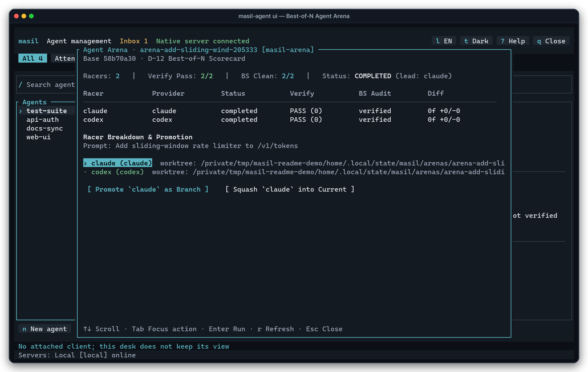

```sh
masil-agent arena start "Add sliding-window rate limiter to /v1/tokens" \
  --racers claude,codex --verify-cmd "cargo test --locked"
masil-agent arena verify <ARENA_ID>
masil-agent arena promote <ARENA_ID> --winner claude --mode branch --losers archive
```

- **Side-by-side scorecard:** compares exit codes of `--verify-cmd`, cross-provider BS audit verdicts, elapsed time, and diff footprints across all racers.
- **Safe promotion:** promote the winner onto a clean `--mode branch` or `--mode squash` onto your current branch (automatically saving a safety checkpoint if your base working tree is dirty), and choose `--losers archive` or `--losers clean`. Optionally synthesize the best parts of multiple racers with `masil-agent arena synthesize <ARENA_ID> --judge claude`.

---

### Fleet Intelligence, Time-Travel DVR & Focus Shield

Built-in guardrails keep multi-agent sessions calm, verifiable, and reversible:

- **Cross-Provider BS Detector (`masil-agent agent audit`):** audits an agent's latest turn against actual git diffs and observed command outputs, flagging unsupported claims or skipped tests with one-click challenge prompts.
- **Cross-Worktree Collision Radar (`masil-agent worktree conflicts|shadow-check|warn`):** detects overlapping dirty edits across sibling worktrees without creating dangling git objects, and lets you warn a sibling agent or run a shadow merge check before committing.
- **Runaway Circuit Breaker & Prompt-Cache Warmth (`masil-agent agent guard`):** detects repetitive retry loops before they burn tokens, lets you extend or dismiss cleanly, and sorts cache-warm sessions to the top while prompt caches are still hot.
- **Time-Travel DVR & Zero-CDN Redacted PR Traces (`masil-agent agent dvr` / `agent trace export`):**
  - Snapshots git tree state per turn (capturing both model edits and Bash side effects), lets you **pin** immortal milestones (`dvr pin`), restore files (`dvr restore`), or fork a fresh worktree branch from any historical turn (`dvr fork`).
  - `masil-agent agent trace export NAME --out trace.html --redact-strict` generates a self-contained, zero-CDN, secret-redacted HTML review trace ready to attach to pull requests.
- **Focus Shield & 90-Second Return Briefing (`masil-agent focus` / `masil-agent briefing`):**
  - `masil-agent focus on 60m` holds routine chimes during deep work while letting circuit-breaker trips and hard collisions through.
  - Returning to your desk? `masil-agent briefing` builds a deterministic 90-second summary bucketed into **Needs Decision**, **Ready to Merge**, and **Review Required**.
- **Opt-in Live Pulse:** optional lock-screen / Dynamic Island (iOS Live Activities) and Android ongoing fleet status — **strictly opt-in and off by default** (`live_activity_enabled = false`).

---

<a id="mobile-companion"></a>

### Mobile Companion App (`mobile/`)

Steer your fleet from Android or iOS over **Noise NK end-to-end encryption** — direct over LAN/Tailscale (port `7767`) or through your own self-hosted `masil-relay`. Nothing leaves your network unencrypted.

<p align="center">
  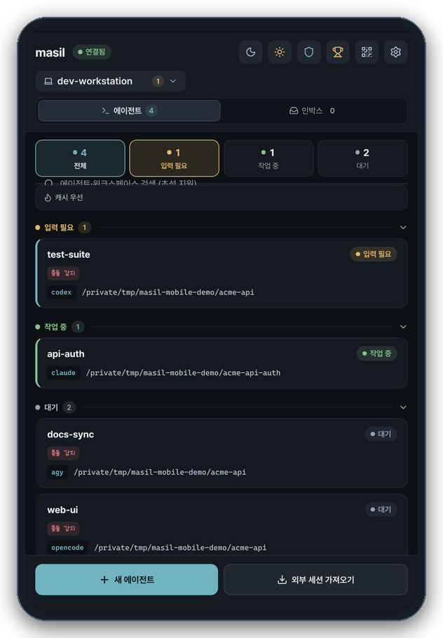
  &nbsp;
  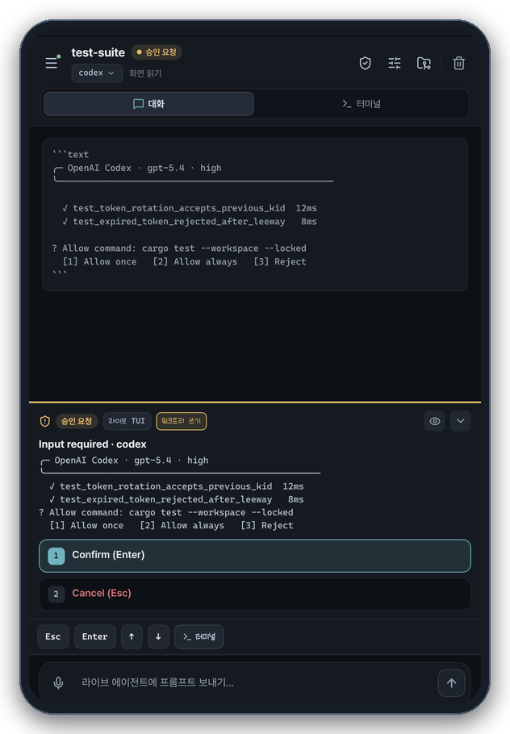
  &nbsp;
  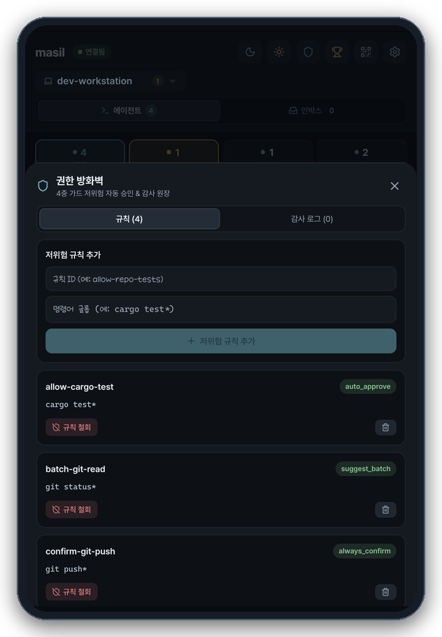
</p>

<p align="center">
  <em>Left: Multi-provider Fleet & Collision Radar · Center: Live Interactive Approval + Risk Badge · Right: Zero-Trust Permission Firewall</em>
</p>

<details>
<summary><b>More mobile screens & E2EE host onboarding wizard</b></summary>

<p align="center">
  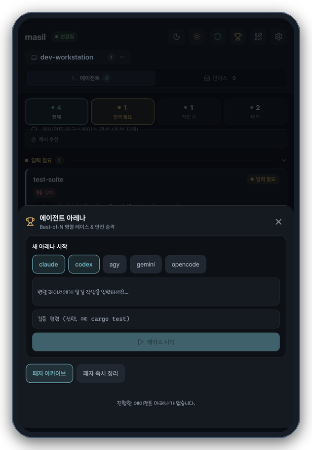
  &nbsp;&nbsp;
  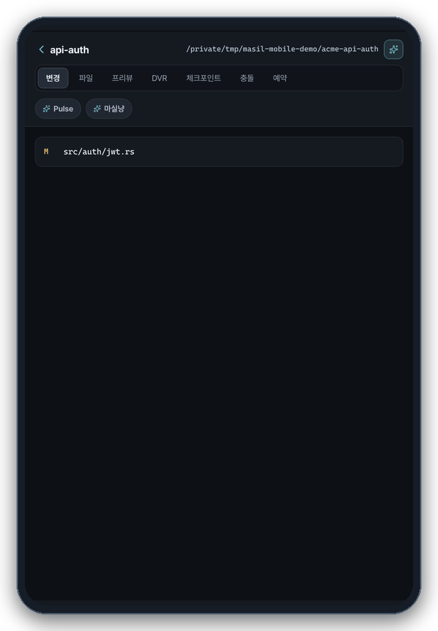
</p>

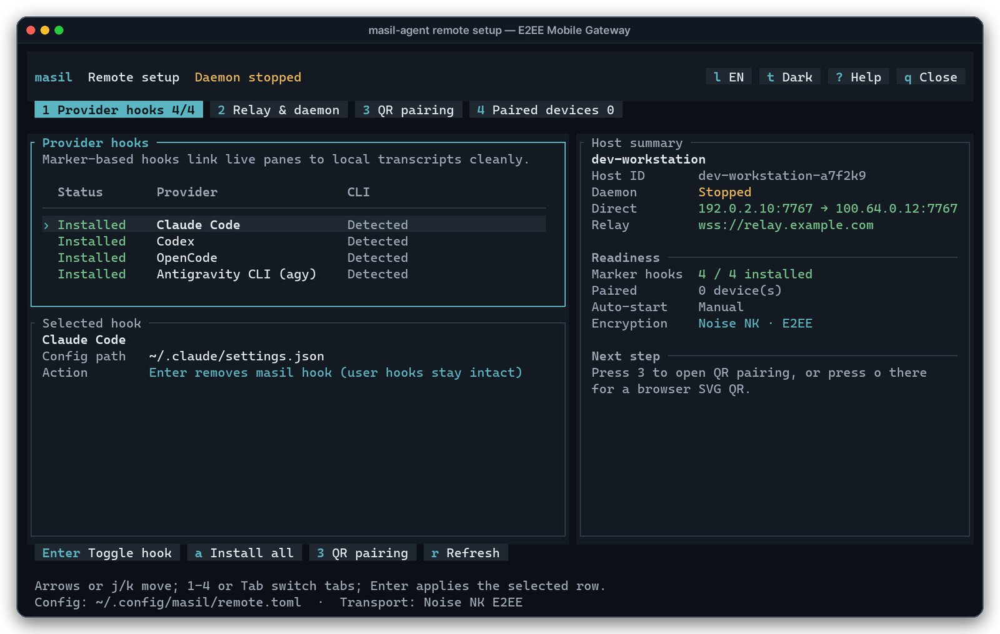

</details>

Key mobile capabilities:

- **Conversation-first reading + Live Terminal canvas:** clean markdown threads collapse noisy tool bursts into 1-line expandable chips; switch to the native **Terminal** tab (`masil-terminal`) anytime for direct PTY control.
- **Interactive approvals & blast-radius badges:** respond to live TUI permission prompts and questions with one tap, plus batch-approve low-risk prompts in a single swipe.
- **E2EE Localhost Preview Tunnel + Visual Markup:** inspect dev servers running on your host (`localhost:3000`, `:5173`, etc.) directly inside the mobile **Preview** tab via the native `masil-tunnel-proxy` loopback bridge, annotate screenshots visually, and send markup straight back to the agent (temporary captures stay cleanly out of `git status` via `.git/info/exclude`).
- **Visual Agent Launcher & Workspace Tools:** browse host folders visually, pick provider/model/reasoning effort/mode/sandbox/new Git worktree, inspect live Git diffs, scrub DVR timelines, review checkpoints, use voice dictation, and switch across multiple paired hosts.
- **Self-hosted Relay (`relay/`):** over LAN/Tailscale no external server is needed. For roaming access without Tailscale, run `masil-relay` on any small VPS (`make relay` or Docker) and pair via `masil-agent remote pair --relay wss://your-relay.example.com`. The relay forwards opaque Noise NK ciphertext only.

---

<a id="local-plugins"></a>

### Local Plugins (Vibe-Codable with Claude Code, Codex & Antigravity)

Extend both the Rust TUI and the Mobile app **without recompiling binaries or rebuilding the APK**. Plugins live in `~/.config/masil/plugins/<id>/` (or any registered local path) and hot-reload across all connected clients.

One plugin (`masil-plugin.toml`) can combine any of six contribution types:

1. **Themes (`theme.toml`):** zero-code Omarchy-style hex palettes synced live between TUI and Mobile.
2. **Workspace panels:** declarative Masil UI Spec v1 blocks (`metric_row`, `table`, `list`, `markdown`, `code`, `diff`, `progress`, `sparkline`, `callout`, `button`, `toggle`, `select`, `form`) rendered natively in Mobile Workspace Tools and the TUI Command Palette (`:`).
3. **Slash commands:** `/command [args]` with autocomplete in the mobile composer and entries in the TUI palette.
4. **Timeline cards:** persistent structured UI cards pushed inline into an agent's conversation view.
5. **Lifecycle hooks:** react to `agent.state_changed`, `agent.started`, `agent.closed`, `inbox.event`, `theme.changed`, and `prompt.before`.
6. **Agent launch presets:** one-tap provider, model, effort, mode, worktree, and initial-prompt chips in the mobile launcher.

#### Install the official `masil-plugin` AI skill

```sh
masil-agent plugin skill install --target all
masil-agent plugin skill status
```

Then ask Claude Code, Codex, or Antigravity directly — or launch **Creator Mode** from Mobile (**Settings → Plugins → Create plugin with AI**) or the TUI Command Palette (`:` → **Create Masil plugin with AI**):

- *"Create a Tokyo Night dark theme plugin for masil and apply it now."*
- *"Build a masil workspace panel showing my repo's TODO checklist and a `/todo` slash command."*
- *"Add a masil hook plugin that posts a summary card whenever an agent enters blocked state."*

Try the bundled starters right away:

```sh
masil-agent plugin install examples/plugins/catppuccin-mocha
masil-agent plugin install examples/plugins/repo-pulse
masil-agent plugin theme set catppuccin-mocha
```

Plugin FD 3 API calls enforce the declared `scope = read|act|admin`, and human approval prompts are never exposed to plugins. See [docs/public/plugins.md](docs/public/plugins.md).

---

<a id="essential-keys"></a>

## Essential keys

Default keys inside **Agent Desk** (`masil-agent agent ui`) and **Sidebar** (`masil-agent agent sidebar`):

| Key | Action |
| --- | --- |
| `j` / `k` · `↑` / `↓` | Move selection (or scroll inspector after `Tab`) |
| `/` | Live filter & search *(supports Korean 초성: `ㄱㅂ` → `개발서버`)* |
| `:` | Open **Command Palette** *(agents, Firewall, Arena, DVR, Briefing, Focus Shield, plugins)* |
| `g` | Jump straight to the selected agent's live terminal pane |
| `Enter` | Open agent details / execute highlighted palette item |
| `n` / `s` | Start a new managed agent / resume a saved session |
| `p` / `d` / `e` | Send safe prompt / prepare draft buffer / open prompt queue |
| `y` / `i` / `u` | Answer approval or question / toggle Inbox / jump to next unseen |
| `f` / `v` / `m` | Inspect Git changes & checkpoints / read live screen / voice dictate |
| `x` / `X` / `r` | Interrupt agent / close pane / rename agent |
| `z` | Expand or collapse Sidebar via native tmux pane zoom |
| `l` / `t` | Switch language (`EN` / `KO`) / cycle theme (`Dark` / `Light` / `Terminal`) |
| `?` / `q` | Live keybinding help / close Agent Desk |

Inside a `masil` terminal session, standard tmux bindings (`C-b` prefix) work unchanged, plus `prefix C-s` saves a session snapshot and `prefix C-r` restores it.

---

## CLI reference

<details>
<summary><b>Agent lifecycle, worktrees & layouts</b></summary>

```sh
masil-agent agent providers                                  # list detected CLIs & evidence
masil-agent agent start NAME PROVIDER [--cwd DIR] [--worktree W] [--split %N]
masil-agent agent list [--all]                               # live fleet across local + SSH
masil-agent agent prompt NAME "run tests"                    # idempotent, SQLite-recorded send
masil-agent agent wait NAME --state idle --timeout 600       # scriptable state wait
masil-agent agent changes NAME                               # dirty files in agent worktree
masil-agent agent checkpoint NAME make|list|restore ...      # previewed single-file rollback
masil-agent agent endpoints add|connect|status ...           # multi-machine SSH fleet control
masil-agent worktree create REPO BRANCH [--setup]            # isolated git worktree
masil-agent layout apply NAME --yes                          # repeatable TOML multi-pane workspace
masil-agent layout columns on                                # horizontally scrollable fixed-width columns
```

</details>

<details>
<summary><b>Zero-Trust Firewall, OS Sandbox, Arena & Time-Travel DVR</b></summary>

```sh
# Permission Firewall
masil-agent policy list
masil-agent policy check "cargo test --locked" --cwd .
masil-agent policy add --id allow-tests --match-command "cargo test*" --max-risk low --action auto_approve
masil-agent policy revoke allow-tests
masil-agent policy log --limit 20

# OS Micro-Sandbox (default ON for managed agents)
masil-agent sandbox status --repo .
masil-agent sandbox trust . --confirm <SHA256>
masil-agent agent start build claude --cwd . --sandbox strict   # or worktree | net-off | --no-sandbox

# Best-of-N Agent Arena
masil-agent arena start "<prompt>" --racers claude,codex --verify-cmd "cargo test"
masil-agent arena list
masil-agent arena verify <ARENA_ID>
masil-agent arena promote <ARENA_ID> --winner claude --mode branch --losers archive
masil-agent arena synthesize <ARENA_ID> --judge claude

# Time-Travel DVR & Zero-CDN Redacted HTML Trace
masil-agent agent dvr list NAME
masil-agent agent dvr snapshot NAME --note "before refactor"
masil-agent agent dvr pin NAME --turn 1 --note "clean baseline"
masil-agent agent dvr restore NAME --turn 1
masil-agent agent dvr fork NAME --turn 1 --branch try/alt-approach
masil-agent agent trace export NAME --out pr-trace.html --redact-strict
```

</details>

<details>
<summary><b>Intelligence, Collision Radar, Focus Shield & Remote Mobile Gateway</b></summary>

```sh
# Intelligence & Safety Rails
masil-agent agent audit NAME [--turn latest] [--challenge FINDING_ID]
masil-agent agent guard NAME status|extend|dismiss
masil-agent worktree conflicts [REPO]
masil-agent worktree shadow-check WT_A WT_B --cmd "cargo test"
masil-agent worktree warn TARGET --about SIBLING

# Focus Shield & 90-Second Return Briefing
masil-agent focus on 60m --reason "deep refactor"
masil-agent focus status
masil-agent focus off
masil-agent briefing --since 8h

# Opt-in E2EE Mobile Gateway
masil-agent remote setup
masil-agent remote status
masil-agent remote pair [--relay wss://relay.example.com] [--open]
masil-agent remote devices
masil-agent remote revoke <DEVICE_ID>
masil-agent remote install-service | uninstall-service
```

</details>

---

## Troubleshooting

Run `masil-agent doctor` (or `masil-agent doctor --versions` / `--bundle DIR`) for a local-only JSON health check with zero network calls.

| Symptom | Fix |
| --- | --- |
| `sandbox.backend` warning in `doctor` | On macOS verify `/usr/bin/sandbox-exec`; on Linux install Bubblewrap (`sudo apt install bubblewrap`). Pass `--no-sandbox` only when explicitly intended. |
| Agent stays `unknown` or misses turns | Install provider marker hooks with `masil-agent remote setup-hooks --install all` (or `masil-agent agent integration export PROVIDER`) and start a fresh run. |
| Mobile app cannot reach host on LAN | Check `masil-agent remote status`, verify port `7767` is reachable over LAN/Tailscale, or pair through a self-hosted `masil-relay`. |
| Want stock tmux with no mouse layer | Launch an isolated server with `masil -f /dev/null`. Stock `tmux` sockets (`tmux-UID`) and binaries are never modified. |
| Scripts hardcode the `tmux` command | Prepend `compat/` to `PATH` in that shell so `tmux` shims cleanly to `masil`. |

---

## Architecture, documentation & development

- **Clean separation of concerns:** `core/` (C, tmux `next-3.9` fork) handles PTYs, VT parsing, and rendering with no proxy in the byte path. `agent/` (Rust) handles multi-provider detection, TUI, SQLite operations, firewall, OS sandbox, Arena, DVR, plugins, and the opt-in remote gateway. `crates/masil-wire/` implements the Noise NK E2EE wire protocol shared with `relay/` and `mobile/`.
- **Public documentation:**
  - [Installation and updates](docs/public/install.md)
  - [Local plugins and AI skill authoring](docs/public/plugins.md)
  - [Provider support and live observations](docs/public/providers.md) · [Observation catalog](docs/public/provider-observations.md)
  - [Architecture and compatibility boundaries](docs/public/architecture.md)
  - [Verification and benchmarks](docs/public/validation.md) · [Performance report (2026-11-18)](docs/public/performance-2026-11-18.md)

<details>
<summary><b>Build & test commands for contributors</b></summary>

```sh
make all && make relay                                  # build bin/masil, bin/masil-agent, bin/masil-relay
cargo fmt --manifest-path agent/Cargo.toml --check
cargo clippy --locked --manifest-path agent/Cargo.toml --all-targets -- -D warnings
cargo test --locked --manifest-path agent/Cargo.toml
make test-ci                                            # core C + management regression gate
make test-relay                                         # Noise NK wire & relay Rust tests
PYTHONPATH=tests python3 -m unittest -v tests/test_phase1.py tests/test_phase2.py tests/test_phase3.py tests/test_plugins_e2e.py tests/test_remote_e2e.py
cd mobile && npm run typecheck && npm test              # mobile app TypeScript & Vitest suite
```

</details>

## License

**masil** is licensed under the [MIT License](LICENSE). `core/` is derived from tmux and retains its ISC License. Bundled mobile fonts (`Pretendard` and `Cascadia Mono`) are licensed under the SIL Open Font License 1.1. See [NOTICE](NOTICE) for full third-party attributions.
